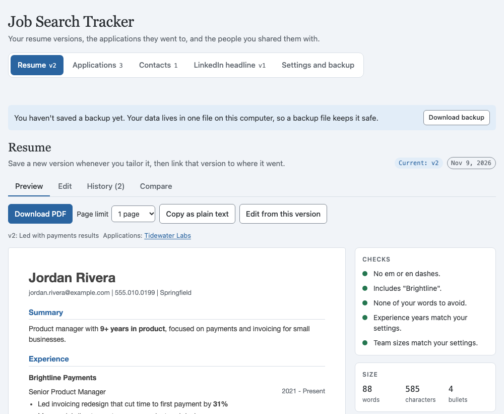

# Search Pipeline & Tracker

A free, open-source job search tracker that runs on your own computer. It keeps every version of your resume, shows which version went to each company and each person, tracks where every application stands, and saves a history of your LinkedIn headline. Your data lives in one file on your machine: no account, no cloud, no tracking.

**Try it in your browser, no install:** [the browser version](https://natalia-builds.github.io/search-pipeline-and-tracker/) (the same tracker, with data kept in your browser instead of a file)

**Download and run it on your computer:** [latest release](https://github.com/natalia-builds/search-pipeline-tracker-app/releases/latest), then the [install steps](#install-and-run)

## Contents

- [Status](#status)
- [Who it's for and the problem it solves](#who-its-for-and-the-problem-it-solves)
- [What it does today](#what-it-does-today)
- [Design decisions and tradeoffs](#design-decisions-and-tradeoffs)
- [Roadmap](#roadmap)
- [Limitations and known gaps](#limitations-and-known-gaps)
- [Install and run](#install-and-run)
  - [First steps](#first-steps)
  - [Your data and backups](#your-data-and-backups)
  - [Moving over from the browser version](#moving-over-from-the-browser-version)
- [For developers](#for-developers)
  - [Run it for development](#run-it-for-development)
  - [Where things live](#where-things-live)
  - [Contributing](#contributing)
  - [License](#license)

## Status

**Version 0.1.0, the first release of the local app.** It works end to end and has automated tests for the server (including its security checks), the browser-side saving, and the resume logic. The screens come from the [browser version](https://github.com/natalia-builds/search-pipeline-and-tracker), which was released first. This version changes where the data lives. So far it has been run on macOS only. The automated tests also run on Linux.

## Who it's for and the problem it solves

Anyone running a job search who tailors their resume for each role. A search produces many versions of a resume, many applications, and people who passed the resume along. It gets hard to say which version a company, or a former colleague, actually has. A spreadsheet can list where you applied, but it can't hold each version or compare them. Hosted trackers keep your resume and your contacts' details on someone else's servers.

The tracker is built around four things:

1. **Resume versions:** save a new version each time you tailor it, with a note about what changed, and compare any two.
2. **Applications:** track each role from Interested to Offer, and record the version you sent.
3. **Contacts:** record who you shared a version with outside an application, and get a warning when they have an older one.
4. **LinkedIn headline:** keep every headline you've used, with when and why it changed.

A version you've sent somewhere can't be deleted, so you always have a record of what each company or person received.

## What it does today

- **Resume:** compare any two versions line by line, download a PDF that fits the page limit you choose (any length, or 1 to 4 pages, as real text that applicant tracking systems can read), and copy the resume as plain text for application forms.
- **Checks you set up yourself:** words every version must include, the years of experience you claim, team sizes, words to avoid, em dashes, and a pay floor. Nothing is built in, so every check comes from your own settings.
- **Applications:** flags for overdue next steps, no posted pay range, pay below your floor, and work setups you want to avoid. Ended roles (rejected, withdrawn, or closed) leave the Active count.
- **Contacts:** which version each person has, and follow-up dates.
- **LinkedIn headline:** a count against LinkedIn's 220-character limit, and a check that the numbers in your headline match your current resume.
- **Backup and restore:** a download of everything as one file, and a restore from it.



## Design decisions and tradeoffs

- **The data is a file you own, not browser storage.** The browser version keeps everything in the browser, so clearing the browser's data erases it. This version saves to one SQLite file (`data/tracker.sqlite`) on the person's computer, and the backup download still works. The tradeoff is that it needs Node.js and a terminal to run, it's tied to one computer, and nothing syncs between computers.
- **Private by default.** There are no accounts, no cloud, no analytics, and no requests to other websites. Fonts and libraries are bundled. The server listens only on `127.0.0.1`, rejects requests with the wrong Host or Origin or without the app's own header, and sends no cross-site permission headers, so a website open in another tab can't read or change the data. The tradeoff is that the project has no usage numbers and can only learn how people use it if they say so.
- **Never lose data silently.** Every save carries a revision number, and the server refuses a save from an out-of-date window instead of overwriting newer work. A failed save is kept and retried, with a visible warning. Data the app can't read is set aside before anything overwrites it. The server keeps one copy of the previous data per day for 30 days. The tradeoff is that if two windows are open and both change something, the older one has to reload and redo its change.
- **Reuse the working screens and change only how they save.** Saving moved behind a small get-and-set store (`serverStore.ts`) that talks to the server, so the existing logic and its tests didn't change. The whole library is stored as one JSON document, not as separate database tables. That keeps backups from the browser version loading unchanged and is plenty for a job search. The tradeoff is that the database can't be searched by application or contact, which would matter if a future feature needed it.
- **Nothing to compile.** SQLite comes from Node itself (`node:sqlite`), so installing means `npm install` with nothing to build for your operating system. The tradeoff is that it needs a recent Node (22.23.4 or newer, set by Astro), and Node still labels this module experimental in some versions, so the start scripts hide its warning.
- **Nothing personal is built in.** No name, employer, number, or city is written into the code. Every check and threshold comes from the person's Settings.
- **Accessibility is a requirement, not an extra.** The screens aim to meet WCAG 2.2 Level AA: real HTML controls, full keyboard use, labels on every field, errors linked to their field, results announced to screen readers, and enough contrast in light and dark mode. [Limitations](#limitations-and-known-gaps) says what hasn't been verified.
- **Small, reviewed changes.** Every change goes through a pull request that is tested and built on two Node versions before it merges. That caught a wrong minimum Node version in the very first pull request.

**Deliberately not built:** accounts or sign-in, hosting or syncing between computers, analytics or tracking, and requests to other websites.

## Roadmap

Live progress for each stage is on the [milestones page](https://github.com/natalia-builds/search-pipeline-tracker-app/milestones).

1. **A double-click installer**, so people don't need Node.js or a terminal. First a decision on the tool, Electron or Tauri ([#7](https://github.com/natalia-builds/search-pipeline-tracker-app/issues/7)). Then it's built in small steps: starting the server from code ([#8](https://github.com/natalia-builds/search-pipeline-tracker-app/issues/8)), a desktop window ([#9](https://github.com/natalia-builds/search-pipeline-tracker-app/issues/9)), saving data in the operating system's app-data folder ([#10](https://github.com/natalia-builds/search-pipeline-tracker-app/issues/10)), a first local build ([#11](https://github.com/natalia-builds/search-pipeline-tracker-app/issues/11)), installers for macOS, Windows and Linux built on each release ([#12](https://github.com/natalia-builds/search-pipeline-tracker-app/issues/12)), and the README update ([#13](https://github.com/natalia-builds/search-pipeline-tracker-app/issues/13)).
2. **Broader testing and accessibility.** Tests on Windows and macOS in CI ([#14](https://github.com/natalia-builds/search-pipeline-tracker-app/issues/14)) and a start-up smoke test ([#15](https://github.com/natalia-builds/search-pipeline-tracker-app/issues/15)). An automated accessibility check ([#16](https://github.com/natalia-builds/search-pipeline-tracker-app/issues/16)) and a written checklist ([#17](https://github.com/natalia-builds/search-pipeline-tracker-app/issues/17)). Then testing by a person with VoiceOver ([#18](https://github.com/natalia-builds/search-pipeline-tracker-app/issues/18)) and in Safari and Firefox ([#19](https://github.com/natalia-builds/search-pipeline-tracker-app/issues/19)), and an update to this README with what was verified ([#20](https://github.com/natalia-builds/search-pipeline-tracker-app/issues/20)).

Beyond these, nothing is committed.

## Limitations and known gaps

- **It needs Node.js and a terminal today.** There's no installer yet.
- **It has only been run on macOS.** Automated tests run on Linux. Windows hasn't been tried.
- **Accessibility isn't fully verified.** The screens have been checked for color contrast in light and dark mode, use at a 375-pixel phone width, labels and error messages on form fields, keeping keyboard focus in place, and announcing results to screen readers. A person hasn't tested them with a screen reader, in Safari or Firefox, or in a full review.
- **One person per install.** There's no sign-in, so anyone who can open this computer's browser to the app can see the data. Run it only on a computer you trust.
- **Nothing syncs between computers.** Use a backup file to move your data.
- **The data folder is inside the project folder.** Deleting the folder deletes the data and the daily copies, because the copies live in the same file. Download a backup now and then.
- **PDFs are US Letter only,** and the tool's text is English only.
- **Resumes use simple marks** for headings, bullets, and dates. There are no tables, columns, images, or custom fonts. See [Formatting your resume](docs/formatting-your-resume.md).

---

## Install and run

You need [Node.js](https://nodejs.org) 22.23.4 or newer (24 is recommended) and [Git](https://git-scm.com).

```bash
git clone https://github.com/natalia-builds/search-pipeline-tracker-app.git
cd search-pipeline-tracker-app
npm install
npm start
```

Then open **http://localhost:4321** in your browser. The first `npm start` takes a few extra seconds to build the app.

To stop it, press **Ctrl+C** in the terminal. Your data is kept. To use a different port: `npm start -- --port 4400`. To update later, run `git pull`, then `npm install`, then `npm start -- --rebuild`.

### First steps

1. Choose **Try it with sample data** to look around with a made-up job seeker. When you're ready for your own, go to **Settings and backup → Delete everything**.
2. **Paste your resume** and select **Save version**. See [Formatting your resume](docs/formatting-your-resume.md).
3. **Set up your checks** in **Settings and backup**. All of them are optional.
4. **Add applications** as you pursue roles, and pick the resume version you sent.
5. **Download a backup** from **Settings and backup** every week or two.

### Your data and backups

Everything is saved in one SQLite file, `data/tracker.sqlite`, inside the project folder. To keep it somewhere else, set `SPT_DATA_DIR` before starting: `SPT_DATA_DIR=~/Documents/job-search npm start`. The `data` folder is excluded from Git, so it won't be committed by accident.

Choose **Settings and backup → Download backup** to save a `.json` file, and keep it somewhere safe, such as a cloud drive. The app reminds you when your last backup is more than two weeks old. Backups and the data file contain your resume and your contacts' details, so keep them as private as the resume itself.

### Moving over from the browser version

Open the [browser version](https://natalia-builds.github.io/search-pipeline-and-tracker/) in the browser you've been using and choose **Settings and backup → Download backup**. Then, in this app, choose **Settings and backup → Restore from a backup file** and pick that file.

---

## For developers

Built with [Astro](https://astro.build) and TypeScript for the screens, a small Node server that uses the SQLite built into Node, [Vitest](https://vitest.dev) for tests, and [jsPDF](https://github.com/parallax/jsPDF) for PDFs. GitHub Actions tests and builds every pull request.

### Run it for development

```bash
npm install      # download the packages the project needs
npm run dev      # app with live reload at http://localhost:4321 (server on 4322)
npm start        # build once, then run the app as people will use it
npm run desktop  # build, then open the app in its own window (Electron). Not an installer yet
npm test         # run the automated tests
npm run build    # build the screens into dist/
```

### Where things live

- [Resume formatting guide](docs/formatting-your-resume.md): the marks the editor understands
- `server/app.mjs`: the local server. It serves the built app and saves the library through `GET` and `PUT /api/library`, with the checks that keep other websites out. `server/start.mjs` starts it from code, and `server/index.mjs` is the command-line start.
- `src/lib/`: the logic and its tests (formatting, comparing versions, checks, backups, PDFs, sample data). `serverStore.ts` is how the screens save through the server.
- `src/scripts/app.ts`: the interactive page. `src/pages/index.astro`: the page shell. `src/styles/app.css`: styles.
- `scripts/`: the `npm start` and `npm run dev` launchers.
- `desktop/`: the Electron window for `npm run desktop`. It runs the same local server and shows it in a window. The first run downloads Electron (about 100 MB or more), and it has only been tried on macOS.
- [CLAUDE.md](CLAUDE.md): the project's principles and working rules

### Contributing

Issues are welcome. [Open one](https://github.com/natalia-builds/search-pipeline-tracker-app/issues) to report a problem or suggest an idea, and open one before a larger change so it can be talked through. Then make a branch, keep the pull request to one purpose, and run `npm test` and `npm run build` before you push. Please keep the app private by default. Never paste your real resume, contacts, or a backup file into an issue, because issues are public.

### License

[MIT](LICENSE). The Carlito font used in PDFs is under the [SIL Open Font License](public/fonts/OFL.txt).
